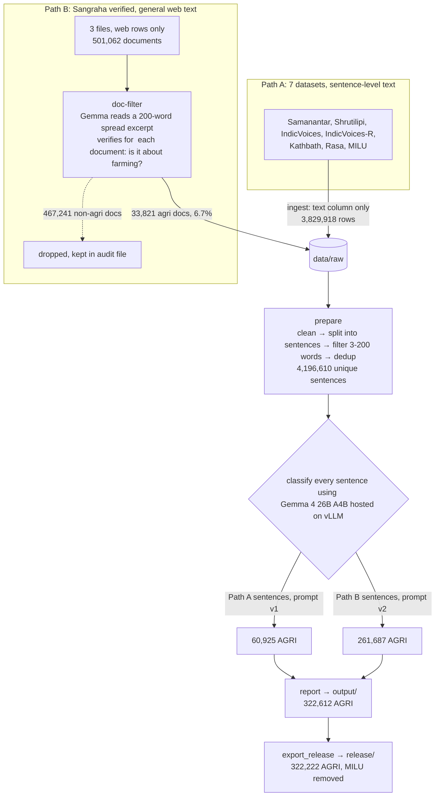

# huggingface-corpus-pipeline: Marathi agriculture sentences from Hugging Face datasets

Builds a corpus of **natural, human-written Marathi sentences about agriculture**,  Text comes from open Hugging Face datasets.
 **Gemma 4 26B A4B**, served with vLLM, is used to classify and label every sentence into - `AGRI` / `NON_AGRI` / `NOT_MARATHI`.

**Result (Draft v0.1):** 4.2M unique sentences labelled → **322,612 AGRI** → **322,222 released** (I have removed MILU sentences as MILU  dataset is used for evaluating datasents using the same in our corpus will add biase and effect eval if needed in future ).

## What the pipeline does



- **Path A, the 7 datasets:** mostly speech transcripts and parallel-corpus text, already short. Every sentence goes straight to the classifier. 1.7% turn out AGRI. later the prompt used to classify was optimised into a better  prompt and used for the path B .
- **Path B, Sangraha:** whole web articles, of which only ~7% are about farming. Classifying every sentence would take ~4 h of GPU per file, to save the time we did screening of every document  **document**, and only  documents with certain high confidence to have agri related info are split into sentences. Each of those sentences is then still classified on its own; 39% are AGRI.
- **Dedup across both paths:** a Sangraha sentence already present in Path A is not added again (7,478 dropped).

Each stage in detail: [docs/PIPELINE.md](docs/PIPELINE.md).

## How to use

Requirements: Linux, an NVIDIA GPU with ≥ 80 GB memory, Python 3.12, about 60 GB of disk for the model weights. All commands run from this folder.

**1. Install**
```bash
python3 -m venv .venv && .venv/bin/pip install uv
.venv/bin/uv pip install --python .venv/bin/python "vllm==0.33.0" -e ".[dev]"
.venv/bin/hf auth login     # token from an account that clicked "Agree and access" on the AI4Bharat datasets
```

**2. Start the classifier server** (the first start downloads ~52 GB)
```bash
mkdir -p logs
nohup scripts/serve.sh > logs/vllm_server.log 2>&1 &
curl -s http://127.0.0.1:8000/v1/models          # ready when it lists the model
```

**3. Build the corpus**
```bash
.venv/bin/marathi-agri run-all     # ingest → doc-filter → prepare → classify → report
```
Or stage by stage:

| Command | Does |
|---|---|
| `marathi-agri ingest` | Download the text columns of Path A sources into `data/raw/` |
| `marathi-agri doc-filter` | Path B: screen Sangraha documents, keep agri ones |
| `marathi-agri prepare` | Clean → split → filter → dedup (CPU) |
| `marathi-agri classify [--only KEY]` | Label sentences on the GPU; `--only` limits it to one source |
| `marathi-agri report` | Write `output/` and `output/report.md` |
| `marathi-agri eval-prompt --csv data/eval/holdout.csv` | Score the prompt against gold labels |

Every stage can be resumed: re-running skips finished files and sentences.

**4. Build the release**
```bash
.venv/bin/python scripts/export_release.py   # → release/data/agri-00000.parquet + dataset card
```

**Add more data** (e.g. more Sangraha files):
1. Add the files to `configs/sources.yaml`.
2. Run `doc-filter` (or `ingest`), then `prepare`, then `classify --only <key>`, then `report`.

Only new sentences go to the GPU.

**Stop the server:** `pkill -f "bin/vllm serve"`

## Outputs

| Path | Content |
|---|---|
| `output/agri.jsonl` | All AGRI sentences with metadata (one JSON per line) |
| `output/sentences.parquet` | All unique sentences with labels |
| `output/report.md` | Counts per source, stage and label |
| `release/` | AGRI-only Parquet + dataset card, ready to publish |

Each sentence carries:
- `text`, `label`, `confidence`
- size: `word_count`, `length_bucket`
- origin: `source_dataset`, `source_file`, `source_row`, `source_license`
- Sangraha only: `doc_id`, `doc_p_agri`
- `prompt_version`

Full field list: [docs/DATASET_CARD.md](docs/DATASET_CARD.md#fields).

## Sources and licenses

| Path | Dataset | License |
|---|---|---|
| A | ai4bharat/Shrutilipi, IndicVoices, IndicVoices-R, Kathbath, Rasa | CC-BY-4.0 |
| A | ai4bharat/MILU: excluded from the release, it is an evaluation benchmark | CC-BY-4.0 |
| A | shivam/marathi_samanantar_processed | Not stated (rows flagged with `license_note`) |
| B | ai4bharat/sangraha, `verified/mar` data-0/1/2, web rows only | CC-BY-4.0 |

Code: Apache-2.0 ([LICENSE](LICENSE)). Citation: [CITATION.cff](CITATION.cff).

## Known limits
- Labels come from one model. A spot-check found ~92–95% of Sangraha AGRI sentences correct; no independent human check yet.
- Path A sentences use the older prompt v1, which is less precise.
- ~1–2% of rows have splitting artifacts (glued sentences, cuts at initials). Exact duplicates are 0; some near-duplicates and template sentences remain.

Details: [docs/DATASET_CARD.md](docs/DATASET_CARD.md#known-issues).

## More documentation

| File | Covers |
|---|---|
| [docs/PIPELINE.md](docs/PIPELINE.md) | Every stage: files, settings, timings, counts, diagrams, resume and extend |
| [docs/TECHNICAL.md](docs/TECHNICAL.md) | Model choice, vLLM hosting and flags, request settings, full prompts, Sangraha run |
| [docs/DATASET_CARD.md](docs/DATASET_CARD.md) | The released dataset: fields, licenses, quality, citation |
| [reports/](reports/) | Run report, exact source commits, run logs |

Development: `.venv/bin/python -m pytest` (no GPU needed) · `.venv/bin/ruff check src tests scripts`
