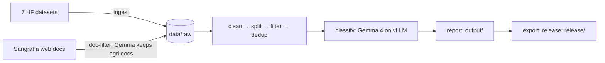

# Marathi agriculture sentence corpus

This pipeline takes Marathi text from Hugging Face datasets, cleans it, splits it into sentences and removes duplicates. It then labels every sentence **AGRI / NON_AGRI / NOT_MARATHI** with **Gemma 4 26B A4B** (zero-shot) served by vLLM.

General web corpora (Sangraha) are mostly not about farming, so they are screened first: Gemma reads a "spread" excerpt of each **document**, and only agri documents are split into sentences (see [Document filter](#document-filter)).

Every output sentence records where it came from (dataset, file, row), its size, and the label and confidence the model gave it.

For how the classifier was chosen, how it is hosted, each vLLM and request setting, the full prompts and the Sangraha run, see [docs/TECHNICAL.md](docs/TECHNICAL.md).

## Outputs

| Path | What it is |
|---|---|
| `output/sentences.parquet` | Every unique sentence with all metadata (the corpus) |
| `output/agri.jsonl` | AGRI sentences only |
| `output/non_agri.jsonl` | NON_AGRI sentences |
| `output/not_marathi.jsonl` | Text the model judged not to be Marathi |
| `output/rejected.parquet` | Rows/sentences dropped during cleaning and filtering, with `reason` |
| `output/samples/*.csv` | 200 random sentences per label, for spot-checking |
| `output/report.md` | Counts per source, label, length bucket, drop reason, confidence; source list |
| `output/trial.csv` | Result of the latest `trial` run (sample classification + speed) |
| `output/doc_trial.csv` | Result of the latest `doc-trial` run (document excerpts, label, P(AGRI)) |

### Release (Draft v0.1)

The published corpus is built from `output/sentences.parquet` with:
```bash
.venv/bin/python scripts/export_release.py      # -> release/data/agri-00000.parquet, release/README.md, release/report.md
```
- **Contents:** AGRI sentences only (322,222), with every field below plus `license_note`.
- **Excluded:** MILU, an evaluation benchmark.
- **Flagged:** Samanantar-copy rows carry `license_note`, because that copy states no license.
- **Where it's published:** a Hugging Face dataset, with the same Parquet attached to the GitHub Release. Links are added at publication.
- **Dataset card:** [`docs/DATASET_CARD.md`](docs/DATASET_CARD.md).

**Licenses:**
- Code: Apache-2.0 ([`LICENSE`](LICENSE)).
- Each corpus row keeps its upstream license (`source_license`).
- The license for this project's own labels and metadata is still to be decided before public release.
- How to cite: [`CITATION.cff`](CITATION.cff).

### Sentence fields

| Field | Meaning |
|---|---|
| `sentence_id` | Stable id: first 16 hex chars of SHA-1 of the normalized text |
| `text` | Cleaned sentence |
| `label` | `AGRI`, `NON_AGRI` or `NOT_MARATHI` (null if not yet classified) |
| `confidence` | Model probability of the emitted label: exp(sum of token logprobs), measured before the label constraint |
| `word_count`, `char_count` | Size |
| `length_bucket` | `short` ≤8 words · `medium` ≤20 · `long` ≤40 · `very_long` >40 |
| `has_end_punct` | Sentence ends with । . ? ! |
| `split_method` | `punctuation`: one of several sentences split from a row · `none`: the row was one sentence · `unsplit_long`: a row over 40 words with no punctuation to split on |
| `source_dataset`, `source_file`, `source_row` | Exact origin of the kept copy |
| `parent_row_id`, `sentence_index` | Original row id (`<source>/<file>#<row>`) and position of this sentence in it |
| `all_sources` | Every dataset the sentence appeared in |
| `dup_count` | Number of times it appeared across all sources |
| `source_license` | License of `source_dataset` |
| `doc_id`, `doc_p_agri` | Document-filtered sources only: upstream document id and the document's P(AGRI); null elsewhere |
| `model_id`, `prompt_version` | Which model and prompt produced the label |

## Sources

| Dataset | Text used | License |
|---|---|---|
| [ai4bharat/Kathbath](https://huggingface.co/datasets/ai4bharat/Kathbath) | `marathi/`, read-speech prompts | CC-BY-4.0 |
| [ai4bharat/Shrutilipi](https://huggingface.co/datasets/ai4bharat/Shrutilipi) | `marathi/`, All India Radio news text | CC-BY-4.0 |
| [ai4bharat/Rasa](https://huggingface.co/datasets/ai4bharat/Rasa) | `Marathi/`, TTS prompts | CC-BY-4.0 |
| [ai4bharat/IndicVoices](https://huggingface.co/datasets/ai4bharat/IndicVoices) | `marathi/`, speech transcripts | CC-BY-4.0 |
| [ai4bharat/indicvoices_r](https://huggingface.co/datasets/ai4bharat/indicvoices_r) | `Marathi/` (subset of IndicVoices) | CC-BY-4.0 |
| [ai4bharat/MILU](https://huggingface.co/datasets/ai4bharat/MILU) | `Marathi/`, question text | CC-BY-4.0 |
| [shivam/marathi_samanantar_processed](https://huggingface.co/datasets/shivam/marathi_samanantar_processed) | `data/`, Marathi side of Samanantar | not stated (derived from Samanantar, CC0) |
| [ai4bharat/sangraha](https://huggingface.co/datasets/ai4bharat/sangraha) | `verified/mar/data-{0,1,2}.parquet` (3 of 34 files), `type == "web"` rows only, agri documents only | CC-BY-4.0 |

- Not used: [ARTPARK-IISc/Vaani](https://huggingface.co/datasets/ARTPARK-IISc/Vaani), which is audio only with no transcripts.
- The exact dataset commit used for each run is recorded in `data/manifest.json` and in the report.
- Only the text column is read from each parquet file; audio is never downloaded.
- Sangraha: the `verified` subset is human-written text (`web` scrapes, `pdf` OCR, `speech` transcripts); only `web` is used. The `synthetic` subset (machine-translated Wikipedia) is never used. To use more of Sangraha, add file paths under `files:` in `sources.yaml`.

> **MILU** is an evaluation benchmark. Including its text in training data contaminates future MILU scores. The release excludes it (`scripts/export_release.py`). To drop it from the pipeline itself, set `enabled: false` in `configs/sources.yaml`.

Please cite the original datasets when using this corpus:
- Kathbath: Javed et al., *IndicSUPERB*, AAAI 2023
- Shrutilipi: Bhogale et al., *Effectiveness of Mining Audio and Text Pairs from Public Data…*, ICASSP 2023
- IndicVoices: Javed et al., *IndicVoices*, ACL Findings 2024
- IndicVoices-R: Sankar et al., NeurIPS 2024 Datasets & Benchmarks
- Rasa: AI4Bharat, *Rasa: Building Expressive Speech Synthesis Systems for Indian Languages*
- MILU: Verma et al., *MILU*, NAACL 2025
- Samanantar: Ramesh et al., TACL 2022
- Sangraha: Khan et al., *IndicLLMSuite*, ACL 2024

## Setup

Requirements: Linux, NVIDIA GPU with ≥80 GB memory (developed on 1× RTX PRO 6000 Blackwell 96 GB), Python 3.12, about 60 GB free disk for the model weights.

```bash
python3 -m venv .venv
.venv/bin/pip install uv
.venv/bin/uv pip install --python .venv/bin/python "vllm==0.33.0" -e ".[dev]"
```

The AI4Bharat datasets are **gated**:
1. Log in to Hugging Face and click "Agree and access" on each gated dataset page above.
2. Give the pipeline a token from that account: `export HF_TOKEN=hf_...` (or run `.venv/bin/hf auth login`).

Gemma 4 itself is not gated (Apache-2.0).

## Running

### 1. Start the classifier server
```bash
nohup scripts/serve.sh > logs/vllm_server.log 2>&1 &
curl -s http://127.0.0.1:8000/v1/models   # ready when this returns the model id
```
The first start downloads about 52 GB of weights.

| Flag | Why |
|---|---|
| `--dtype bfloat16` | Full precision, no quantization |
| `--max-model-len 4096` | Prompt ≈1.5k tokens + one sentence |
| `--enable-prefix-caching` | The shared prompt and examples are processed once and reused for every sentence |
| `--max-num-seqs 512`, `--max-num-batched-tokens 16384` | Many short requests in parallel |
| `--limit-mm-per-prompt.image 0` | Text only; frees the memory the vision encoder would reserve |
| `--generation-config vllm` | Ignore the model's default sampling; requests set temperature 0 |
| no `--reasoning-parser` | Thinking stays off; the chat template inserts an empty thought block |
| `--host 127.0.0.1` | Reachable only from this machine |

### 2. Run the pipeline
```bash
.venv/bin/marathi-agri check              # access + text column of every source
.venv/bin/marathi-agri ingest             # text columns -> data/raw/   (--only <key> for one source)
.venv/bin/marathi-agri doc-trial --n 200  # optional: screen a document sample, check P(AGRI)
.venv/bin/marathi-agri doc-filter         # doc_filter sources: keep agri documents -> data/raw/
.venv/bin/marathi-agri prepare            # clean -> split -> filter -> dedup
.venv/bin/marathi-agri trial --n 2000     # optional: label a random sample, measure speed
.venv/bin/marathi-agri classify           # label all unique sentences (resumable)
                                          #   --only <key>: just one source's sentences
.venv/bin/marathi-agri report             # write output/
```
`run-all` does ingest → doc-filter → prepare → classify → report in one go. Each stage can also be run on its own: `clean`, `split`, `filter`, `dedup`.

**Resuming and extending:**
- `ingest` skips files it already has; `doc-filter` skips files it has already screened.
- `classify` stores results by `sentence_id`, so an interrupted run continues where it stopped.
- After adding a source to `configs/sources.yaml`, run `ingest` / `doc-filter`, `prepare`, then `classify --only <key>`. Dedup runs over all sources, so sentences already in the corpus are not added again, and only the new source's sentences go to the model.
- Changing `PROMPT_VERSION` in `prompt.py` makes a plain `classify` re-label everything; `classify --only <key>` re-labels just that source. The report gives each sentence its newest available label, and `prompt_version` records which prompt produced it. In the current corpus, the 7 original sources carry v1 labels and Sangraha carries v2.

## How it works



The full pipeline is in **[docs/PIPELINE.md](docs/PIPELINE.md)**: diagrams with real counts, files read and written per stage, commands, timings, and how to resume or extend a run.

| Stage | What happens |
|---|---|
| ingest | Read only the text column of each parquet file over `HfFileSystem`, pinned to the dataset's current commit |
| doc-filter | For `doc_filter: true` sources: keep `row_filter` rows, screen each document (below), write kept documents to `data/raw/` and an audit of every document to `data/docfilter/` |
| clean | Unicode NFC. Remove ASR tags (`[noise]`, `<unk>`, `(laugh)`; bracketed Marathi is kept), URLs, emails and invisible characters (ZWJ/ZWNJ kept). Normalize `॥`/`\|` to `।`. Collapse whitespace |
| split | Split on `।` `?` `!` and sentence-final `.`, skipping abbreviations (डॉ., श्री., इ.स., कि.मी.), decimals and list numbers. Newlines are boundaries. Text without punctuation stays whole |
| filter | Drop sentences with fewer than 3 words, more than 200 words, or less than 80% Devanagari letters. Add size fields and the length bucket |
| dedup | Key = NFC text with punctuation removed, case-folded, whitespace collapsed. The first copy is kept in `sources.yaml` order, so punctuated sources win over unpunctuated Samanantar. `all_sources` and `dup_count` record all copies |
| classify | One chat request per sentence: system prompt + 27 Marathi few-shot examples + the sentence. Output is restricted to the three labels (`structured_outputs.choice`), temperature 0, thinking off. 256 requests in flight, retries with backoff |
| report | Join labels to sentences, write the corpus files, samples and `report.md` |

Thresholds and sizes live in `configs/pipeline.yaml`; sources live in `configs/sources.yaml`.

### Classification prompt (v2)
In `src/marathi_agri/prompt.py`:
1. **Language check, language only:** Hindi, Konkani or other Devanagari text, romanized Marathi, or gibberish → `NOT_MARATHI`. Short, fragmentary, spoken or misspelled Marathi is still Marathi, and so is Marathi about other states or countries.
2. **AGRI** if the main subject is farming or the farm economy: crops, soil, water/irrigation, plant protection, horticulture, livestock and allied activities, farm machinery, agri markets/MSP/credit/insurance/schemes, weather *as it affects crops*, agri institutions, and everyday farm talk.
3. **Borderline:** protests, loan waivers and compensation are AGRI only when the text gives farm-economy substance (amounts, scheme terms, prices, crop damage).
4. **NON_AGRI** for everything else, including: politics that only mentions farmers; vague farmer-distress statements; general weather; food, recipes and nutrition; idioms and brands; drinking water; gardening; bare word lists; agriculture as one item in a list of sectors.
5. **Tie-break:** when unsure, NON_AGRI.

**v1 → v2, measured on 600 hand-labelled sentences** (`data/eval/`, labelled by Claude, deliberately enriched with hard cases, so absolute precision is lower than on the corpus as a whole). `marathi-agri eval-prompt --csv <file>` reproduces the scores.

| Set | Prompt | AGRI precision | AGRI recall | Accuracy | Wrong NOT_MARATHI |
|---|---|---|---|---|---|
| dev (400; the prompt was tuned once on it) | v1 | 0.51 | 0.97 | 0.57 | 99 |
| | v2 | 0.67 | 0.83 | 0.83 | 22 |
| held-out (200; never used for tuning) | v1 | 0.36 | 1.00 | 0.51 | 50 |
| | v2 | 0.50 | 0.89 | 0.84 | 5 |

### Document filter
For general web text (Sangraha, about 7% agri documents) classifying every sentence would take days, so whole documents are screened first:
1. **Spread read:** the cleaned document's opening (up to 100 words), then sentences at evenly spaced positions through the rest, up to 200 words in total, with `…` marking gaps. This is deterministic, and it catches agri content in the middle of digest-style pages.
2. **Document prompt `d1`:** the same agriculture definition; AGRI if the main topic *or a substantial part* is farming. 4 few-shot excerpts, output restricted to AGRI / NON_AGRI.
3. **Keep rule:** labelled AGRI **or** P(AGRI) ≥ 0.2, where P(AGRI) is read from the first answer token's top logprobs. This leans toward recall because every sentence of a kept document is classified again on its own.

Settings: `doc_excerpt_words`, `doc_head_words`, `doc_keep_threshold` in `configs/pipeline.yaml`.

## Development
```bash
.venv/bin/python -m pytest      # unit + pipeline tests (no GPU or network needed)
.venv/bin/ruff check src tests
.venv/bin/ruff format src tests
```

## Layout
```
configs/        pipeline.yaml (settings), sources.yaml (datasets)
scripts/        serve.sh (vLLM server), export_release.py (builds release/)
docs/           PIPELINE.md (stages + diagrams), TECHNICAL.md (model, hosting, settings, prompts), DATASET_CARD.md
reports/        report.md, manifest.json (exact source commits), logs/ (run logs)
src/marathi_agri/
  config.py     typed config        ingest.py   HF download + check
  text.py       clean/split/measure prepare.py  clean, split, filter stages
  dedup.py      cross-source dedup  prompt.py   sentence + document prompts
  classify.py   vLLM client         report.py   corpus files + report.md
  docfilter.py  document filter     evaluate.py prompt scoring vs gold labels
  cli.py        commands
tests/
data/eval/      gold-labelled evaluation sets (versioned)
data/           other intermediate stage files (not versioned)
output/         full labelled corpus + report (not versioned; regenerate with the pipeline)
release/        built release files (not versioned; published separately)
```

## Limitations
- Labels come from one model with no human annotation. `confidence` and `output/samples/` are the means to check them.
- Samanantar-processed has no punctuation, so its long rows cannot be split into sentences. They are kept and tagged `unsplit_long`.
- Dedup is exact (after normalization). Near-duplicates that differ by a word are kept.
- Document filter: agri sentences inside documents judged NON_AGRI are never seen.
- Gemma sometimes labels short, fluent Marathi as NOT_MARATHI, even unconstrained (a model limitation, not a decoding issue). Few of these are agri.
- The prompt evaluation labels were written by Claude, who also wrote the prompt; a native-speaker review would give an independent measure.
