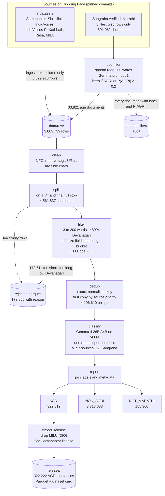
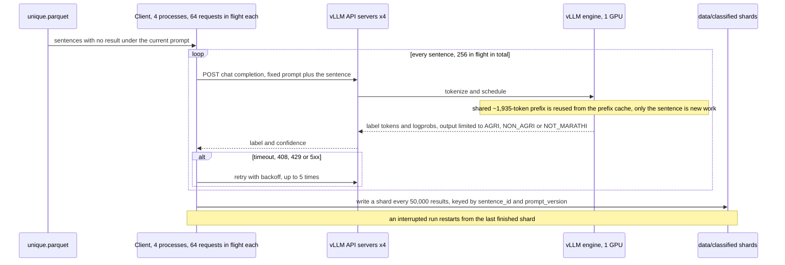
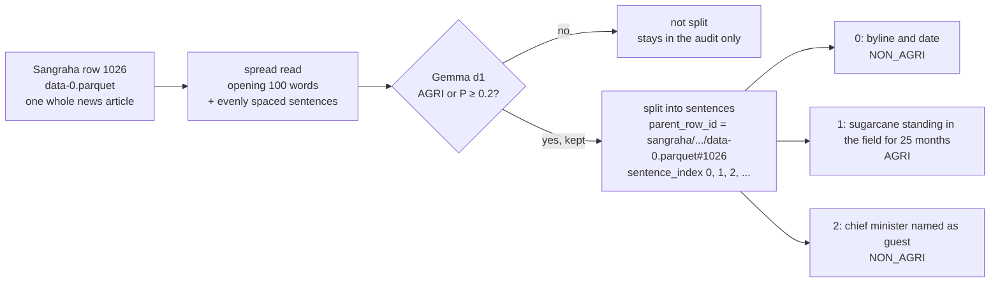

# Pipeline overview

How raw Hugging Face datasets become the released Marathi agriculture corpus: every stage, the files it reads and writes, the code and command that run it, and the real counts from the Draft v0.1 run.

- **Settings and the reasons behind them** (model choice, vLLM flags, prompts): [`TECHNICAL.md`](TECHNICAL.md)
- **The released dataset** (fields, licenses, quality): [`DATASET_CARD.md`](DATASET_CARD.md)
- **Run artifacts** (report, exact source commits, logs): [`../reports/`](../reports/)

---

## 1. End-to-end flow

**Three things to know:**
1. **Two entry paths, one shared pipeline.** The original 7 sources go straight to `data/raw/`. Sangraha is general web text (only ~7% agri), so whole documents are screened first and only agri documents enter `data/raw/`. After that, every row takes the same path.
2. **Labels are per sentence.** The document filter only decides which documents get split. Each sentence is still classified on its own: 39% of the sentences from agri documents end up AGRI.
3. **Nothing is lost silently.**
   - Dropped rows go to `rejected.parquet` with a reason.
   - Every screened document is in the doc-filter audit.
   - Every duplicate is recorded in `all_sources` and `dup_count`.

---

## 2. Stages

| # | Stage | Command | Code | Reads → writes | Key settings | Runs on | Time (this run) |
|---|---|---|---|---|---|---|---|
| 1 | Ingest | `marathi-agri ingest` | `ingest.py` | HF parquet → `data/raw/<source>/` + `data/manifest.json` | `sources.yaml`: files, text column; pinned revision | CPU + network | ~3 min |
| 1b | Document filter | `marathi-agri doc-filter` | `docfilter.py`, `prompt.py` (d1) | HF parquet → `data/docfilter/<source>/` (audit) + `data/raw/<source>/` (kept docs) | `row_filter: {type: web}`, `doc_excerpt_words 200`, `doc_head_words 100`, `doc_keep_threshold 0.2` | GPU | ~93 min (3 files, ~89 docs/s) |
| 2 | Clean | `marathi-agri clean` | `prepare.py`, `text.py` | `data/raw/` → `data/cleaned.parquet` | `workers 8` | CPU | prepare (2–5) together: ~2 min |
| 3 | Split | `marathi-agri split` | `prepare.py`, `text.py` | `cleaned.parquet` → `split.parquet` (+ `rejected.parquet`) | `unsplit_long_words 40` | CPU | |
| 4 | Filter | `marathi-agri filter` | `prepare.py` | `split.parquet` → `filtered.parquet` (+ `rejected.parquet`) | `min_words 3`, `max_words 200`, `min_devanagari_ratio 0.8`, `length_buckets` | CPU | |
| 5 | Dedup | `marathi-agri dedup` | `dedup.py` | `filtered.parquet` → `unique.parquet` | source priority = order in `sources.yaml` | CPU | |
| 6 | Classify | `marathi-agri classify [--only KEY]` | `classify.py`, `prompt.py` (v1/v2) | `unique.parquet` → `data/classified/shard-*.parquet` | `concurrency 256`, `client_processes 4`, `max_tokens 5`, `shard_size 50000` | GPU | 2 h 55 min (3.53M, v1) + 46 min (664k, v2) |
| 7 | Report | `marathi-agri report` | `report.py` | `unique.parquet` + `data/classified/` + `data/docfilter/` → `output/` | `samples_per_label 200`, `target_agri_sentences 200000` | CPU | ~35 s |
| 8 | Release | `python scripts/export_release.py` | `scripts/export_release.py` | `output/sentences.parquet` → `release/` | MILU excluded; Samanantar `license_note` | CPU | seconds |

`marathi-agri prepare` runs stages 2–5 in one go. `marathi-agri run-all` runs 1 → 1b → 2–5 → 6 → 7.

**Before the long runs, two optional checks:**
- `marathi-agri trial --n 2000`: labels a sample of sentences and measures speed.
- `marathi-agri doc-trial --n 200`: screens a sample of documents and reports P(AGRI).

### Funnel per source

| Source | Raw rows | Sentences after split | After filter | Unique (kept copy) | Already in a higher-priority source | AGRI |
|---|---|---|---|---|---|---|
| Samanantar (shivam copy) | 3,047,226 | 3,049,806 | 2,961,023 | 2,855,635 | 5,261 | 32,713 |
| Kathbath | 86,448 | 86,448 | 86,448 | 86,334 | 0 | 2,337 |
| Shrutilipi | 336,475 | 336,475 | 328,157 | 301,198 | 13 | 15,811 |
| Rasa | 29,955 | 33,665 | 29,684 | 24,819 | 524 | 405 |
| IndicVoices | 302,939 | 302,595 | 256,823 | 251,501 | 476 | 9,269 |
| IndicVoices-R | 19,141 | 19,141 | 18,858 | 23 | 18,806 | 0 |
| MILU | 7,734 | 15,614 | 13,779 | 13,248 | 3 | 390 (not released) |
| Sangraha (kept docs) | 33,821 | 718,093 | 693,454 | 663,852 | 7,478 | 261,687 |
| **Total** | **3,863,739** | **4,561,837** | **4,388,226** | **4,196,610** | | **322,612** |

IndicVoices-R is a subset of IndicVoices, so nearly all its sentences are duplicates.

### Rows dropped

| Reason | Stage | Rows |
|---|---|---|
| `too_short` (< 3 words) | filter | 157,721 |
| `low_devanagari` (< 80% Devanagari letters) | filter | 15,822 |
| `empty_after_clean` | split | 344 |
| `too_long` (> 200 words, unsplittable) | filter | 68 |
| **Total** | | **173,955** |

### Length buckets (set at the filter stage)

| Bucket | Words | Released AGRI sentences | Share |
|---|---|---|---|
| `short` | 3–8 | 68,334 | 21.2% |
| `medium` | 9–20 | 190,971 | 59.3% |
| `long` | 21–40 | 56,750 | 17.6% |
| `very_long` | 41+ | 6,167 | 1.9% |

Thresholds are in `configs/pipeline.yaml` → `length_buckets`. The bucket comes from `word_count` only.

---

## 3. Classification: what happens per sentence

- **Re-running is safe:** a sentence that already has a result under the current `prompt_version` is never sent again.
- **Changing the prompt version** makes `classify` label everything again under the new version. `classify --only <source>` limits that to one source.
- **Newest label wins:** the report takes the newest label per sentence, so older sources can keep their v1 labels while Sangraha uses v2.

---

## 4. From a Sangraha document to labelled sentences

Every released Sangraha sentence keeps `doc_id`, `parent_row_id`, `sentence_index` and `doc_p_agri`. Any sentence can be traced back to its article, and the article can be rebuilt in order.

---

## 5. Re-running and extending

| Goal | Steps |
|---|---|
| Resume after a crash | Re-run the same command. `ingest` and `doc-filter` skip finished files; `classify` skips finished sentences |
| Add a source (e.g. more Sangraha files) | 1. Add it to `configs/sources.yaml` 2. Run `ingest` or `doc-filter`, then `prepare`, then `classify --only <key>`, then `report` Dedup runs over all sources, so sentences already in the corpus are not added again, and only new sentences go to the GPU |
| Change the prompt | Bump `PROMPT_VERSION` in `prompt.py` (and `PROMPT_HISTORY`), check it with `eval-prompt --csv data/eval/holdout.csv`, then run `classify` (everything) or `classify --only <key>` |
| Rebuild the release | `report`, then `python scripts/export_release.py` |
